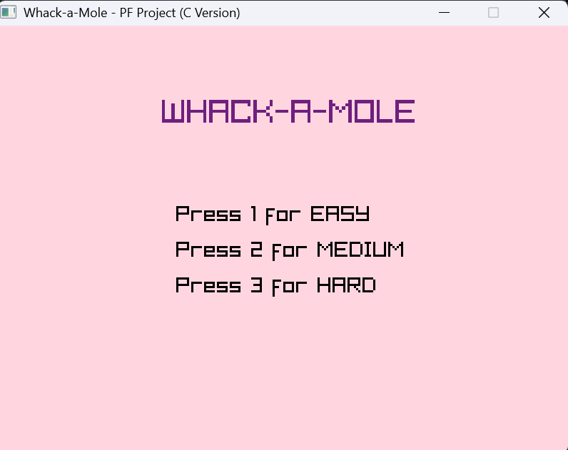
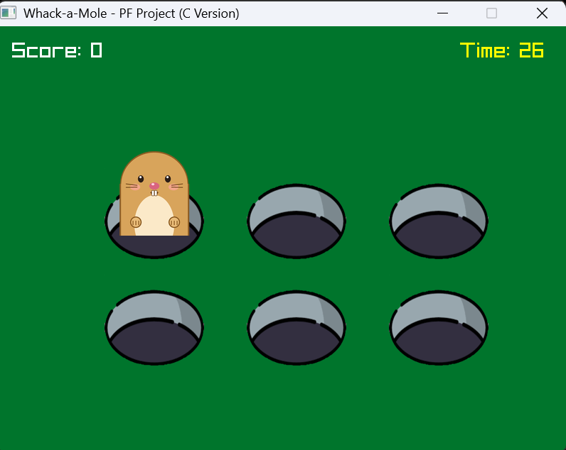
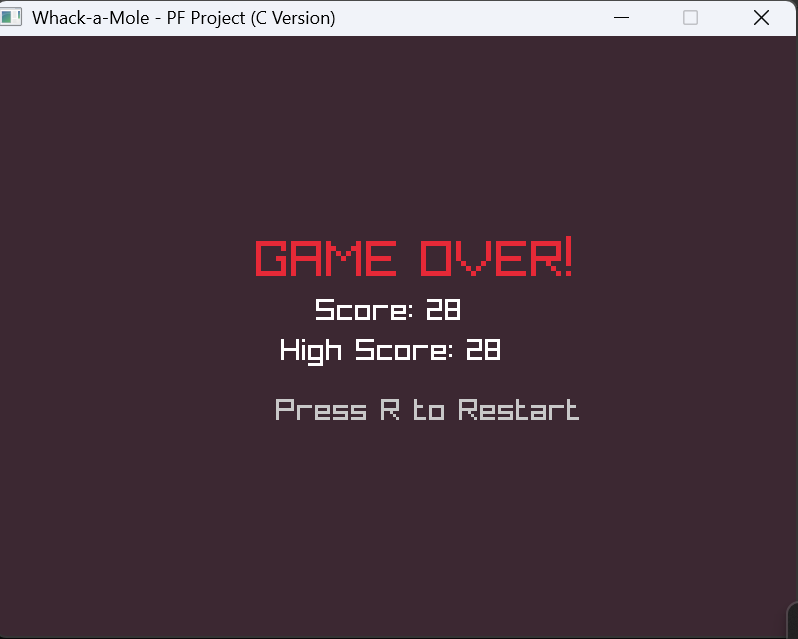
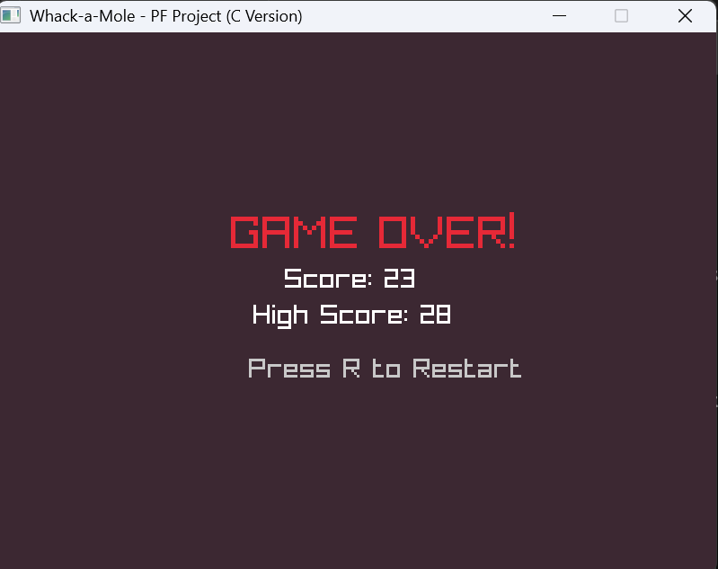

# Whack-a-Mole (C + raylib)

A Whack-a-Mole game written in **C** with the **raylib** graphics library.
Moles pop out of holes, and you click them before they disappear. Made as a
Programming Fundamentals project at FAST-NUCES.

| Name | Roll No |
|---|---|
| Aliza Syed | 25K-6580 |
| Zunairah Ahmed | 26K-2043 |
| Syeda Aniqa Ahmed | 26K-2056 |

**Section:** BSCY 1-B, FAST-NUCES

---

## Screenshots

### Menu screen
Choose a difficulty with the number keys.

### Gameplay
A mole pops out of a hole. Click it to score a point.

### Game over screen
Shows your final score.

### High score
Shows your final score and the highest score reached so far.

---

## Features

- 3 difficulty levels (Easy, Medium, Hard) that change how fast moles appear
- 6 holes with moles popping up at random
- Live score counter and a countdown timer
- High score that is remembered between rounds while the game is open
- Achievements: **Mole Beginner** (10 points) and **Mole Master** (25 points)
- Background music, plus mole and hole images
- Restart instantly after game over

## Controls

| Key / Input | Action |
|---|---|
| `1` / `2` / `3` | Choose Easy / Medium / Hard on the menu |
| Left mouse click | Whack a mole |
| `R` | Restart after game over |

## How to run (Windows)

1. Install **raylib** with the official Windows installer to `C:\raylib`
   (it includes the `w64devkit` compiler): <https://www.raylib.com>
2. Install **Visual Studio Code** and the **C/C++** extension.
3. Download or clone this repository and open the folder in VS Code.
4. Press **Ctrl+Shift+B** to build. This creates `main.exe`.
5. Run `main.exe` from the project folder.

> Keep `mole.png`, `hole.png` and `song.mp3` in the same folder as `main.exe`,
> because the game loads them by file name when it starts.

## Project files

| File | Purpose |
|---|---|
| `main.c` | All of the game code |
| `mole.png`, `hole.png` | Game images |
| `menu.png`, `gameplay.png`, `gameover.png`, `highscore.png` | Screenshots of the game |
| `song.mp3` | Background music |
| `Makefile` | Build instructions used by `make` |
| `.vscode/tasks.json` | Makes Ctrl+Shift+B build the game in VS Code |

## What we learned

- Using raylib to open a window, draw images and text, and read keyboard and mouse input
- Structuring a game with a main loop (update, then draw)
- Using `struct` and arrays to store the holes and moles
- Timing with `GetFrameTime()` so the game runs at the same speed on any computer
- Using variables to keep score and a high score

## Resources and credits

- raylib by Ramon Santamaria: <https://www.raylib.com>
- raylib cheatsheet (all functions): <https://www.raylib.com/cheatsheet/cheatsheet.html>
- VS Code starter template, setup tutorial and C basics by Programming with Nick:
  <https://www.youtube.com/watch?v=PaAcVk5jUd8>
- Example inspiration (video) it was of C++ : <https://youtu.be/d-3XPAqBS2M>
- GeeksforGeeks for C theory

